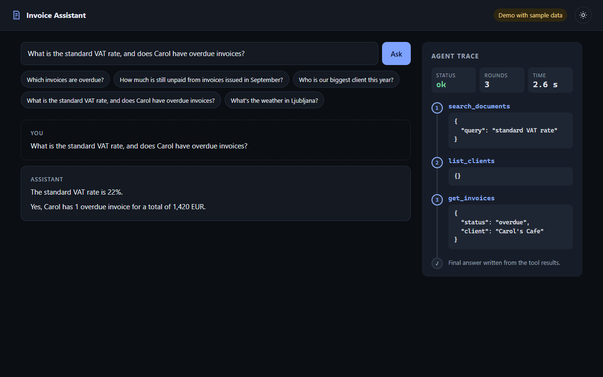
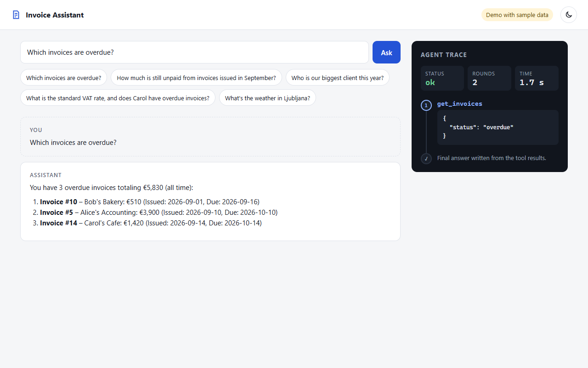
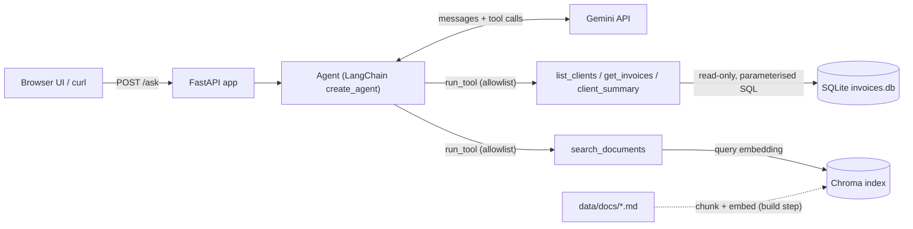

# Invoice Assistant: RAG + Tool-Calling Agent Project
### Ori Gonen

## Project Abstract

A small chat assistant that answers questions about a business's invoices and about tax and invoicing rules. An LLM agent decides, for each question, which tools to use:
- **Data tools** that query a read-only SQLite invoice database
- A **document tool** (RAG) that searches a set of markdown "tax rules" with local embeddings in Chroma

It can use any combination of them, or none, and then writes the final answer. 
The agent is exposed via a FastAPI endpoint and a web UI that shows the tool calls it made.

This is a **learning and demo project**: it runs on fake sample data, has no users, and the documents are fake. 
I built it to learn how agents, tool calling and RAG work.

Want to run it? See [Setup and run](#setup-and-run).

---
## Video Demo
https://github.com/user-attachments/assets/6784a5ae-c027-45f0-b739-517a3307aad0

(If it doesn't load, try [here!](media/demo-video.mp4))

Video demo generated by Claude Code.

---

Dark and light modes are available.






---

## What it can answer

| Kind | Example | Tool(s) used |
|---|---|---|
| Data | "Which invoices are overdue?" | `get_invoices` |
| Data | "How much is still unpaid from invoices issued in September?" | `get_invoices` |
| Data | "Who is our biggest client this year?" | `client_summary` |
| Document | "What is the standard VAT rate?" | `search_documents` |
| Mixed | "What is the standard VAT rate, and does Carol have overdue invoices?" | `search_documents` + `list_clients` + `get_invoices` |
| Off-topic | "What's the weather in Ljubljana?" | none (polite refusal) |

## Architecture



## How the agent decides which tool to use

1. Each tool is described to the model with a name, a description and a JSON Schema for its parameters (`TOOL_DECLARATIONS` in `app/tools.py`)
2. The question and tool declarations are sent to the model. The model doesn't run anything: it answers in text or replies with a structured tool request (e.g., `get_invoices({"status": "overdue"})`)
3. The code checks the tool name against an allowlist, runs the Python function, and sends the result back to the model
4. This repeats until the model returns a plain text answer (a round limit exists to prevent indefinite loops)

The tool descriptions are what steer the choice: "invoice amounts, clients, due dates" points to the data tools, "VAT, rules, deadlines" to the document search. The API returns the full trace (`tool_calls`, `rounds`, `seconds`) so every decision is visible.

## The RAG

- **Chunking:** each `##` section of the markdown docs becomes one chunk (18 chunks), prefixed with its document title so the chunk has context on its own
- **Embedding:** chunks are embedded locally with `sentence-transformers/all-MiniLM-L6-v2` (normalised vectors), so no document text is sent to an embedding API
- **Storage and search:** vectors are stored in a local Chroma collection with cosine distance. `search_documents(query, k=3)` embeds the query and returns the 3 closest chunks
- **Generation:** the agent passes those chunks to the model as the tool result, and the model answers from them

## Two agent implementations

| File | How | Why |
|---|---|---|
| `app/agent.py` | Hand-written loop on Gemini's Interactions API (`google-genai`), with retries for transient errors, a step limit, and `store=False` | To understand the mechanism first |
| `app/agent_langchain.py` | LangChain `create_agent` with `ChatGoogleGenerativeAI` | The version behind the API |

Both expose the same interface, `run_agent(question) -> AgentResult(answer, status, tool_calls, rounds, seconds)`, so they are interchangeable.


## Security and privacy

- **The LLM never writes SQL queries**. It can only call predefined Python functions with typed parameters, and those functions use parameterized queries
- **The database is opened read-only** (`mode=ro` in the SQLite URI), so even a bug in a tool can't modify or delete data
- **Tool allowlist:** only functions registered in `TOOLS` can be executed
- **Untrusted output:** the UI renders model answers as text (`textContent`), never as HTML, to prevent XSS.
- **Local embeddings:** document text is embedded on the machine, not sent to an embedding API.
- **Secrets** live in `.env`, which is, of course, gitignored

What a production version would still need: authentication and rate limiting, HTTPS, no logging of client data, per-tenant data isolation, and a review of the LLM provider's data-retention terms.


## Limitations

- **Fake data.** 23 hand-written invoices for 5 clients and 4 short sample legal documents
- **No conversation memory.** Each question is answered independently, so the user cannot pose follow-up questions
- **Simple chunking.** One chunk per section. No size-based splitting was implemented, as all sections in my example were very short.
- **No automated evaluation.** The behavior was checked manually with a fixed set of questions against known answers, not with an automated test suite.
- **The data is not private.** This is because questions, invoice data, and document chunks are all sent to the Gemini API, and the provider might store them. This can be solved by running the LLM locally (which has drawbacks of hardware and electricity costs, generation speed, and agent intelligence).

## Future work
- Automated evaluation
- Conversation memory for follow-up questions
- A relevance threshold for document search, and size-based chunking
- A predictive feature, e.g. a scikit-learn model estimating whether an invoice will be paid late
- Slovenian language documents and questions


---

#### From here to the end, the README is written completely by Claude.

---


## Tech stack

- Python 3.12
- LLM: Google Gemini (`gemini-3.5-flash-lite`) via `google-genai` 2.31.0 and `langchain-google-genai` 4.4.2
- Agent: `langchain` 1.4.6, `langgraph` 1.2.16
- Embeddings: `sentence-transformers` 6.1.0 (all-MiniLM-L6-v2, runs locally)
- Vector store: `chromadb` 1.5.9 (local, persistent)
- Database: SQLite (standard library)
- API: `fastapi[standard]` 0.156.1
- UI: one static HTML page with plain JavaScript (no build step), designed by Claude Design.

All versions are in `requirements.txt`.

## Project structure

```
app/
  agent.py             hand-written agent loop (Interactions API)
  agent_langchain.py   LangChain agent (used by the API)
  api.py               FastAPI app: /, /ask, /health
  retrieval.py         chunking, embeddings, Chroma, search_documents
  tools.py             read-only SQL tools, tool declarations, allowlist
  static/index.html    web UI
data/
  seed_db.py           creates data/invoices.db with 23 sample invoices
  docs/                sample tax and invoicing rules (markdown)
media/                 screenshots and demo video for this README
scripts/
  call.ps1             PowerShell helper to call /ask
hello_gemini.py        API-key smoke test
.env.example           required environment variables
```

---

## Setup and run

Tested on Windows 11 with PowerShell 7 and Python 3.12. macOS/Linux equivalents are shown where commands differ.

### 1. Prerequisites
- Python 3.12
- A free Gemini API key from [Google AI Studio](https://aistudio.google.com/)
- On Windows, use PowerShell 7 (`pwsh`). Windows PowerShell 5.1 mis-decodes UTF-8 responses (e.g. `€` shows as `â¬`).

### 2. Clone and install
```powershell
git clone https://github.com/OriGonen/InvoiceAssistant-RAG.git
cd InvoiceAssistant-RAG
py -3.12 -m venv .venv
.\.venv\Scripts\Activate.ps1          # macOS/Linux: source .venv/bin/activate
pip install -r requirements.txt       # several minutes; includes PyTorch
```
If activation fails with "running scripts is disabled", run once:
`Set-ExecutionPolicy -Scope CurrentUser RemoteSigned`

### 3. Configure
```powershell
Copy-Item .env.example .env           # macOS/Linux: cp .env.example .env
```
Edit `.env` and set `GEMINI_API_KEY`. `APP_TODAY` pins "today" to a fixed date (2026-10-19) so answers about overdue invoices are reproducible; remove it to use the real date.

### 4. Build the data
Neither the database nor the search index is committed; both are generated locally:
```powershell
python data/seed_db.py                # creates the SQLite DB with 23 sample invoices
python -m app.retrieval build         # embeds data/docs/ into a local Chroma index (18 chunks)
```
Rerunning either command resets it to the initial state. The first run downloads the embedding model (~90 MB). The first import of PyTorch after install can take a minute on Windows.

### 5. Run
**Command line** (one question; prints the tool calls the agent made):
```powershell
python -m app.agent_langchain "Which invoices are overdue?"
python -m app.agent "Which invoices are overdue?"     # the hand-written loop
```

**API and web UI:**
```powershell
fastapi dev app/api.py
```
- Web UI: http://127.0.0.1:8000/
- Interactive API docs: http://127.0.0.1:8000/docs
- From PowerShell, with the server running: `.\scripts\call.ps1 "Which invoices are overdue?"`

Always run commands from the project root with the virtual environment active.

### Optional
- A "sending unauthenticated requests to the HF Hub" warning is harmless. To silence it once the model is downloaded, set `$env:HF_HUB_OFFLINE = "1"` (macOS/Linux: `export HF_HUB_OFFLINE=1`) before running. It has no effect in `.env`, because the embedding library is imported before `.env` is loaded.
- `python hello_gemini.py` checks that your API key works.

---

## API

### `POST /ask`

Request:
```json
{ "question": "Which invoices are overdue?" }
```

Response (200):
```json
{
  "answer": "You have 3 overdue invoices totaling 5,830.00 EUR (all time): ...",
  "status": "ok",
  "tool_calls": [ { "name": "get_invoices", "args": { "status": "overdue" } } ],
  "rounds": 2,
  "seconds": 1.8
}
```

| Status | Meaning |
|---|---|
| 200 | Answer produced |
| 422 | Invalid input (empty, or longer than 500 characters after trimming) |
| 502 | The model call failed (e.g. API error, bad model name) |
| 504 | The agent hit its step limit without a final answer |

Error responses contain a generic message only; details are logged on the server console.

### `GET /health`
Returns `{"status": "ok"}`. The `/ask` endpoint is a plain (sync) function, so FastAPI runs it in a threadpool and `/health` stays responsive while a slow question is being answered.

---


## Disclaimer

All invoices, clients and "tax rules" in this repository are invented sample data.